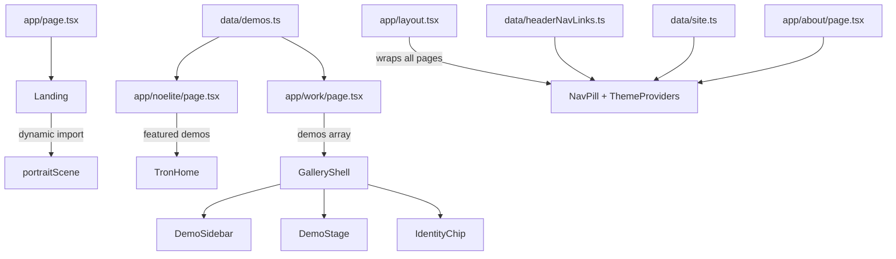

# File Structure

This project is a [Next.js](https://nextjs.org) App Router app. Home is a full-screen stage with a particle portrait; the old scroll story lives at `/noelite`. `/work` is the demo gallery (sidebar, live iframe). About is a short bio. See [architecture.md](./architecture.md) for the scroll setup.

## Directory overview

```
portfolio/
├── app/                      # Next.js routes, layout, and global styles
├── components/               # React UI components
│   ├── landing/              # `/` stage: corner entries, particle portrait, contact window
│   ├── transition/           # Home → page hand-off: curtain + staggered entrance
│   ├── home/                 # `/noelite` scroll story (+ tron.css shared with about/journey/noelite2)
│   ├── noelite2/             # `/noelite2` scroll-driven 3D journey (SDD 028, was /journey)
│   ├── journey/              # `/journey` grid.log work-experience page (SDD 030)
│   └── gallery/              # Gallery-specific components
├── data/                     # Static content (demos, nav links, site identity)
├── lib/                      # Small shared helpers: withBasePath, sound (site-wide Web Audio UI sounds)
├── docs/                     # Project documentation
├── public/                   # Static assets served at /
├── next.config.ts            # Next.js config (images, CSP, headers)
├── package.json              # Dependencies and scripts
├── postcss.config.mjs        # PostCSS / Tailwind pipeline
└── tsconfig.json             # TypeScript paths and compiler options
```

Generated folders like `.next/` and `node_modules/` are build artifacts — you can ignore them.

---

## How the page is assembled



1. **`app/layout.tsx`** wraps every page with fonts, theme support, metadata, and the top header.
2. **`app/page.tsx`** renders the full-screen home stage (`Landing`). **`app/noelite/page.tsx`** keeps the previous Legacy-to-Ares scroll story.
3. **`app/work/page.tsx`** renders `GalleryShell` (selected demo, sidebar, project details).
4. **`app/about/page.tsx`** is a short bio and contact page — not a second homepage.

---

## `app/`

| File | Role |
|------|------|
| `page.tsx` | Home route (`/`). Loads Oxanium + Share Tech Mono and renders `Landing`. |
| `noelite/page.tsx` | `/noelite`: the previous home, the scroll story (`TronHome`). |
| `noelite2/page.tsx` | `/noelite2`: the scroll-driven 3D journey preview (SDD 028), moved from `/journey`. |
| `journey/page.tsx` | `/journey`: grid.log, the work-experience journey (SDD 030). |
| `work/page.tsx` | Gallery route (`/work`). Passes `demos` to `GalleryShell`. |
| `about/page.tsx` | About route (`/about`). Bio, focus, and contact links. |
| `layout.tsx` | Root HTML shell: Inter font, metadata, `ThemeProviders`, `NavPill`, and `RouteCurtain` (home → page transition). |
| `theme-providers.tsx` | Client wrapper around `next-themes` for light / dark / system mode. |
| `globals.css` | Tailwind import, dark-mode variant, custom cursor, and `.no-scrollbar` utility. |
| `icon.svg` | Favicon (initials-style mark). |
| `opengraph-image.tsx` | Generated Open Graph image for link previews. |

**Entry point:** start at `page.tsx` if you want to change what renders on `/`.

---

## `components/`

Shared UI that is not tied to a specific route.

| File | Role |
|------|------|
| `ThemeSwitch.tsx` | Sun/moon toggle button used inside the header. |

### `components/landing/`

The `/` stage ([SDD 029](./sdd/029-portrait-home.md)).

| File | Role |
|------|------|
| `Landing.tsx` | Client component: stage, name, corner entries, hover / focus / tap selection, WebGL vs static fallback, mounts the scene. |
| `entries.ts` | The four corner entries (number, mono label, title, route) and the contact links. |
| `ContactPanel.tsx` | Tron window for 04 Contact (Email, GitHub, LinkedIn, Resume); ESC / backdrop / × close. |
| `poses.ts` | Pose config map: entry → photo, crop, tilt, spin, scale, line width, depth, accent. Add poses here. |
| `sampler.ts` | Turns a photo crop into particle positions and colours (alpha / contrast mask, local contrast, depth). |
| `portraitScene.ts` | The single three.js renderer: instanced line particles, cursor push, trail (dust + photo reveal), pose morphs, drag / wheel rotation. |
| `landing.css` | Stage, name, corners, contact window, mobile 2×2 layout, fallback, page-exit animations. |

### `components/transition/`

The home → page transition ([portrait-home.md](./pages/portrait-home.md#leaving-for-a-page-work-journey-about)).

| File | Role |
|------|------|
| `routeTransition.ts` | `beginRouteExit` (sessionStorage flag + curtain), flag helpers, and `ENTRANCES`: per-page selectors in entrance order. Edit this to change what comes in first. |
| `RouteCurtain.tsx` | Mounted once in `app/layout.tsx`. Dark curtain; on arrival with a fresh flag it tags the page's blocks and plays the staggered entrance, otherwise does nothing. |
| `route-transition.css` | Curtain (below the header, `--site-nav-h`), header crossfade during the hand-off, scan line, entrance keyframes (filter / translate / clip-path only), reduced-motion overrides. |

### `components/noelite2/`

The `/noelite2` 3D journey ([SDD 028](./sdd/028-journey-home.md)): `Journey.tsx` (fixed WebGL stage over a scroll track, HUD), `journeyScene.ts` + `scene/*` (desk, Grid, city, portal, name), `path.ts` (camera path and acts), `JourneyFallback.tsx` (2D poster / reduced-motion fallback), `journey.css`. CSS classes keep their `journey-*` names.

### `components/journey/`

The `/journey` grid.log page ([SDD 030](./sdd/030-journey-gridlog.md), [walkthrough](./pages/journey-gridlog.md)): `GridLog.tsx` (bar, panel row, HEAD panel, count-up, fallbacks), `track.ts` (wheel / drag / swipe / keys / hash row controller), `Rail.tsx` (SVG branch graph: labelled nodes, light cycle, trailing HEAD dots), `markField.ts` (three.js instanced-dash particle mark), `journey.css`; the arrival sound is `playArrive` in `lib/sound.ts`. Content comes from `data/experience.ts`.

### `components/home/`

The `/noelite` scroll story (the previous home). `TronHome` lays out five scenes. `useHomeScroll` starts ScrollSmoother, the pins, and the `--tron` handoff. `tron.css` holds the grid, ribbon, and scene colors.

### `components/gallery/`

These files implement the gallery layout.

| File | Role |
|------|------|
| `GalleryShell.tsx` | **Orchestrator.** Manages selected demo, sidebar collapse (defaults collapsed on small screens), and the project-details overlay. |
| `DemoSidebar.tsx` | Left column: thumbnail list with titles, selection outline, collapse animation, ⌘+[ shortcut. Title row toggles the details card. |
| `DemoStage.tsx` | Center: iframe (or fallback card if embedding is blocked), scaled to fit, with an optional name/blurb/Live/GitHub overlay. |
| `NavPill.tsx` | Fixed top header: alexW, Work, Journey, About (on `/` these three play the home exit via `requestHomeExit`), social icons, the site-wide sound toggle (speaker, `localStorage['gridlog-sound']`), an Available status, and the local date and time (time only at 400 px or narrower). Header link clicks play their `lib/sound.ts` blip. On `/` the bar is dark glass and its edge follows `--tron`. |
| `IdentityChip.tsx` | Bottom-left chip with name and role; links to About. Collapses on small screens. |
| `PillButton.tsx` | Reusable rounded button/link used by the sidebar toggle, header icons, and identity chip. |

**Client vs server:** files marked `'use client'` run in the browser (state, events, theme). `page.tsx` stays a server component and only passes data down.

## `lib/`

| File | Description |
| --- | --- |
| `withBasePath.ts` | Prefixes `/portfolio` to asset paths on the GitHub Pages build. |
| `sound.ts` | Site-wide UI sounds (Web Audio, no files): one lazily created `AudioContext` for the visit, unlocked on the first gesture; `playClick(target)` for header links and home corners, `playClose()` for the contact window, `playTick()`, `playArrive()` for the `/journey` rail; on/off saved in `localStorage['gridlog-sound']`. |

---

## `data/`

Static content — no API calls. Edit these files to change what the gallery shows.

| File | Role |
|------|------|
| `demos.ts` | **Main content file.** Exports the `Demo` type, `demoLiveUrl()`, and the `demos` array. |
| `site.ts` | Name, role, tagline, contact URLs, highlights, the About toolkit, and hobbies. |
| `headerNavLinks.ts` | Nav items for the header (Home, Work, Journey, About; Discs hidden until revealed). |
| `experience.ts` | Work history for `/journey` (from the resume): `STEPS` (MMU on `edu`, then each job on `main`) and the `HEAD` panel, plus date / hash helpers. |

### `Demo` shape

```ts
type Demo = {
  name: string
  slug: string
  thumb: string
  embedUrl: string
  liveUrl?: string      // defaults to embedUrl
  repoUrl?: string
  blurb: string
  tags: string[]
  isNew?: boolean
  embeddable?: boolean  // set false if the host refuses iframes
  note?: string         // opens the Details slide-over
}
```

To add a demo, append an object to `demos` and drop a thumbnail in `public/thumbs/`. If a host sends `X-Frame-Options` or `frame-ancestors` that blocks embedding, set `embeddable: false` so the stage shows an “Open live site” fallback.

---

## `public/`

Files here are served from the site root. Thumbnails live in `public/thumbs/`. The home portrait photos (cut-out WebP with alpha, EXIF stripped) live in `public/portrait/`.

---

## Root config files

| File | Role |
|------|------|
| `next.config.ts` | Allows iframes from `noowxela.github.io` and `*.vercel.app` via CSP `frame-src`. |
| `tsconfig.json` | TypeScript config; `@/*` alias maps to the project root. |
| `postcss.config.mjs` | Enables Tailwind CSS v4 via `@tailwindcss/postcss`. |
| `eslint.config.mjs` | Lint rules for the project. |
| `package.json` | Scripts: `dev`, `build`, `start`, `lint`. Key deps: `next`, `react`, `gsap`, `@headlessui/react`, `next-themes`. |

---

## Common customization paths

| Goal | Where to look |
|------|----------------|
| Add or remove gallery items | `data/demos.ts` |
| Change name, email, socials | `data/site.ts` |
| Change nav links | `data/headerNavLinks.ts` |
| Change page title / SEO | `app/layout.tsx` → `metadata` |
| Tweak sidebar or iframe behavior | `components/gallery/DemoSidebar.tsx`, `DemoStage.tsx` |
| Change colors, cursor, scrollbar | `app/globals.css` |
| Allow iframes from a new host | `next.config.ts` → CSP `frame-src` |

---

## Scripts

```bash
npm run dev    # local dev server at http://localhost:3000
npm run build  # production build
npm run start  # serve production build
npm run lint   # ESLint
```
