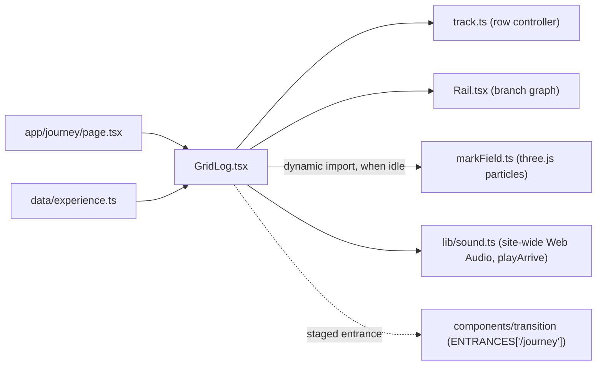

# Journey: grid.log

`/journey` tells Alex's work history as a git log on the Tron grid. Design and decisions: [SDD 030](../sdd/030-journey-gridlog.md). The 3D ride that used to live here is now `/noelite2` ([SDD 028](../sdd/028-journey-home.md)).

Code lives in `components/journey/`; the content lives in `data/experience.ts`. `app/journey/page.tsx` only loads the fonts (Oxanium, Share Tech Mono) plus `tron.css` and `journey.css`, and renders `GridLog`.

## What is on the page

| Layer (back to front) | What it is |
| --- | --- |
| Void + floor | The shared 72 px perspective grid floor (`.grid-pit`) and a faint cyan haze. |
| Particle mark | One WebGL canvas behind the panels. The current step's `mark` (`2016–20`, `2021–23`, `2023–25`, `2025–26`, `NEXT`) drawn in short dashes, all Tron cyan (`#5ce1ff`; pushed dashes flash cyan-white). It is 0.57 × the original size (`MARK_SCALE`; about 140 px font / 96 px ink on a 1440 px screen, 53 px / 37 px on a 390 px phone) and sits at the top of the stage, the top of its ink 12 px under the bar (10 px on phones, `MARK_TOP` in `markField.ts`), in the band above the current panel's frame. The morph fly-out, scatter and cursor push shrink with it. It morphs to the next mark when the step changes, scatters with wheel / drag speed, and is pushed away by a moving cursor. |
| Bar | `~/grid / journey.log`, `5 commits · 2 branches`, the input hint, and the Resume link (`site.resume`). |
| Row | Five panels in one horizontal row, oldest first. The current one is centred, framed with corner brackets and lit; the others are dimmed to 20 %. Panel width `clamp(420px, 46vw, 680px)` on desktop, 86vw on phones. |
| Branch rail | SVG at the bottom: the dashed ember `edu` lane merging into `main`, one node per step labelled underneath `MMU`, `Auronex`, `Oasis`, `Trinergy` (the `short` field in `data/experience.ts`; the current one glows), then three cyan dots trailing off after Trinergy ("more to come"). The dots are the HEAD button. A lit trail follows the row position up to the last step; the light-cycle head follows it continuously (also mid-drag) and rides out onto the dots for HEAD. Nodes are buttons with a years + company tooltip. |

## Panels

Each panel shows: short hash, branch, commit message; the heading (company, linked when the resume has a link); role, place and dates; the condensed resume bullets; and technology tags (only ones the resume names).

| Step | Branch | Hash |
| --- | --- | --- |
| Multimedia University, B.CS (Data Science), 06/2016–11/2020 | `edu` | `#e299fa` |
| Auronex Sdn Bhd, Software Engineer, 05/2021–07/2023 | `main` (merge of `edu`) | `#ef5e76` |
| Oasis Interactive Malaysia, Frontend Developer, 11/2023–02/2025 | `main` | `#7d3d11` |
| Trinergy Digital, Full-Stack Developer, 02/2025–08/2026 | `main` | `#a90f2f` |
| HEAD, next commit: the resume summary, contact links, About (the three dots on the rail) | `main` | `#32694b` |

Hashes are a 6-hex FNV hash of the step id, so they are stable. To add a job, append a `Step` to `STEPS` in `data/experience.ts` with its `mark`; the row, the rail, the particle marks and the counts follow.

## Moving through it

- Wheel (vertical or horizontal) moves the row freely and snaps to the nearest panel 140 ms after the last event.
- Drag with the mouse, or swipe, moves one panel per gesture (a release past 16 % of the spacing counts). Vertical swipes are left to the browser, so the long Trinergy panel scrolls inside its own body on phones; a fade at the bottom shows there is more.
- Left / Right arrows step, Home / End jump to the ends. Clicking a rail node, the three dots (HEAD) or a dim panel jumps there. Tabbing into a panel brings it to the centre. The dots are a real button (`Next commit — available`), so HEAD is reachable by Tab + Enter.
- The URL hash follows the step (`replaceState`, no history spam). Opening `/journey/#7d3d11` starts on Oasis; changing the hash moves the row.

## Arriving from Home

When the Home's Journey corner is clicked, the curtain covers the page below the header and `ENTRANCES['/journey']` stages: the floor, then the bar, then the current panel's lines (up to 12), then the rail. Direct visits, reloads and back / forward show no entrance. The particle field is built only after the entrance ends and the browser is idle, so building it never lands on an entrance frame.

## Arrival sound

When the row settles on a different step (the light cycle arrives at a node), a short blip plays. It is synthesised with the Web Audio API by `playArrive` in the site-wide `lib/sound.ts` (the same voice the header and home corners use); there are no audio files.

- Voice: a triangle wave that glides down a fifth into the note in 30 ms (the "zap"), plus a sine an octave up at 35 % that dies a little faster (the "chime"), through a 3.2 kHz low-pass. Envelope 6 ms attack, exponential decay to silence in 190 ms. Master volume 0.18.
- Pitch per node (pentatonic): MMU C5 523 Hz, Auronex D5 587 Hz, Oasis E5 659 Hz, Trinergy G5 784 Hz. HEAD (the dots) plays a two-note rise, G5 then C6 (1047 Hz) 70 ms later.
- Only on settle, so wheeling or swiping across several steps gives one blip at the end; at most one blip per 120 ms besides.
- Never on load or on arriving by a deep link (that first settle is skipped). Changing the hash on an open page (back / forward, a link) does play it.
- Browsers start audio only after a user activation, so the `AudioContext` is created on the first click, tap or key press, and only while `navigator.userActivation.isActive` (no "AudioContext was not allowed to start" warning). A wheel is not an activation: if the visitor only scrolls, the page stays silent until they click, tap or press a key. The context is shared by the whole site and lives on across client-side route changes, so leaving `/journey` no longer closes it.
- Toggle: the speaker icon in the site header (before `available`), on every page (`aria-label="Sound effects"`, `aria-pressed`). On by default; the choice is saved in `localStorage['gridlog-sound']` (`'0'` / `'1'`). It used to sit in this page's top bar.

## Fallbacks

- `prefers-reduced-motion`: no particles (no canvas); the mark is static outlined neon text. The row snaps without tweens, no count-up, the HEAD dots do not pulse.
- No WebGL (missing API, disabled, or renderer fails / context lost): same static mark. Everything else works.
- One WebGL context; DPR capped at 2; the field stops drawing when settled (idle shimmer at ~30 fps) and pauses while the tab is hidden; `forceContextLoss()` on unmount, so leaving the page leaves no canvas.
