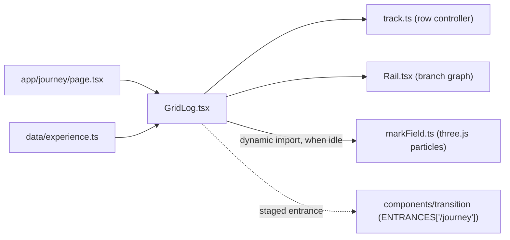

# Journey: grid.log

`/journey` tells Alex's work history as a git log on the Tron grid. Design and decisions: [SDD 030](../sdd/030-journey-gridlog.md). The 3D ride that used to live here is now `/noelite2` ([SDD 028](../sdd/028-journey-home.md)).

Code lives in `components/journey/`; the content lives in `data/experience.ts`. `app/journey/page.tsx` only loads the fonts (Oxanium, Share Tech Mono) plus `tron.css` and `journey.css`, and renders `GridLog`.

## What is on the page

| Layer (back to front) | What it is |
| --- | --- |
| Void + floor | The shared 72 px perspective grid floor (`.grid-pit`) and a faint cyan haze. |
| Particle mark | One WebGL canvas behind the panels. The current step's `mark` (`2016–20`, `2021–23`, `2023–25`, `2025–26`, `NEXT`) drawn in short cyan dashes. It morphs to the next mark when the step changes, scatters with wheel / drag speed, and is pushed away by a moving cursor. |
| Bar | `~/grid / journey.log`, `5 commits · 2 branches`, the input hint, and the Resume link (`site.resume`). |
| Terminal line | `alex@grid:~$ git checkout <hash> --detach && git show <hash>`. The hash scrambles into the new one (32 ms per character) on every change. HEAD shows `git checkout main && git status`. |
| Row | Five panels in one horizontal row, oldest first. The current one is centred, framed with corner brackets and lit; the others are dimmed to 20 %. Panel width `clamp(420px, 46vw, 680px)` on desktop, 86vw on phones. |
| Branch rail | SVG at the bottom: the dashed ember `edu` lane merging into `main`, a dashed segment to HEAD, one node per step. A lit trail and a light-cycle head follow the row position continuously (also mid-drag). Nodes are buttons with tooltips. |

## Panels

Each panel shows: short hash, branch, commit message; the heading (company, linked when the resume has a link); role, place and dates; the condensed resume bullets; technology tags (only ones the resume names); and stats (months computed from the dates; `3 developers led` for Trinergy). The numbers count up over 650 ms when the panel becomes current.

| Step | Branch | Hash |
| --- | --- | --- |
| Multimedia University, B.CS (Data Science), 06/2016–11/2020 | `edu` | `#e299fa` |
| Auronex Sdn Bhd, Software Engineer, 05/2021–07/2023 | `main` (merge of `edu`) | `#ef5e76` |
| Oasis Interactive Malaysia, Frontend Developer, 11/2023–02/2025 | `main` | `#7d3d11` |
| Trinergy Digital, Full-Stack Developer, 02/2025–08/2026 | `main` | `#a90f2f` |
| HEAD, next commit: the resume summary, contact links, About | `main` | `#32694b` |

Hashes are a 6-hex FNV hash of the step id, so they are stable. To add a job, append a `Step` to `STEPS` in `data/experience.ts` with its `mark`; the row, the rail, the particle marks and the counts follow.

## Moving through it

- Wheel (vertical or horizontal) moves the row freely and snaps to the nearest panel 140 ms after the last event.
- Drag with the mouse, or swipe, moves one panel per gesture (a release past 16 % of the spacing counts). Vertical swipes are left to the browser, so the long Trinergy panel scrolls inside its own body on phones; a fade at the bottom shows there is more.
- Left / Right arrows step, Home / End jump to the ends. Clicking a rail node or a dim panel jumps there. Tabbing into a panel brings it to the centre.
- The URL hash follows the step (`replaceState`, no history spam). Opening `/journey/#7d3d11` starts on Oasis; changing the hash moves the row.

## Arriving from Home

When the Home's Journey corner is clicked, the curtain covers the page below the header and `ENTRANCES['/journey']` stages: the floor, then the bar and terminal line, then the current panel's lines (up to 12), then the rail. Direct visits, reloads and back / forward show no entrance. The particle field is built only after the entrance ends and the browser is idle, so building it never lands on an entrance frame.

## Fallbacks

- `prefers-reduced-motion`: no particles (no canvas); the mark is static outlined neon text. The row snaps without tweens, no scramble, no count-up.
- No WebGL (missing API, disabled, or renderer fails / context lost): same static mark. Everything else works.
- One WebGL context; DPR capped at 2; the field stops drawing when settled (idle shimmer at ~30 fps) and pauses while the tab is hidden; `forceContextLoss()` on unmount, so leaving the page leaves no canvas.
