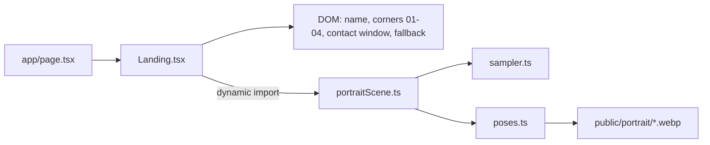

# Home: the particle portrait stage

The page at `/` is one full-screen stage (100dvh, no page scroll). The old scroll story is at `/noelite` ([tron-home.md](./tron-home.md)). Design and decisions: [SDD 029](../sdd/029-portrait-home.md).

Code lives in `components/landing/`. `app/page.tsx` only loads the fonts (Oxanium, Share Tech Mono) plus `tron.css` and `landing.css`, and renders `Landing`.

## What is on the stage

| Layer (back to front) | What it is |
| --- | --- |
| Void + haze | `--void` ground, a faint cyan radial glow, a perspective grid floor that slowly runs toward the viewer (same 72 px grid as `/noelite` and `/journey`). |
| Portrait (`.landing-stage`) | The single WebGL canvas: Alex as short cyan line segments in two sheets, front and back, 15k each (5k each on phones), plus one photo plane per side for the reveal. Like a coin, both faces show the same portrait, and the back reads the right way round. The sheet facing away is almost invisible. Fades in over 0.7 s. |
| Scanlines + frame | `.tron-scan` and `.scene-frame` from `tron.css`. |
| Name | "alex woon" in Oxanium, neon cyan glow, role line above in Share Tech Mono. Plain DOM, `pointer-events: none`. |
| Corner entries | 01 Work (top left), 02 Journey (top right), 03 About (bottom left), 04 Contact (bottom right). Red number, mono file label (`gallery.grid`, `journey.run`, `profile.sys`, `contact.app`), title, and an `ENTER ▸` tag when selected. |
| Contact window | `contact.app`: Email, GitHub, LinkedIn, Resume (same links as the `/noelite` exit scene and the nav's "available" menu, from `data/site.ts`). ESC, ×, or a click outside closes it; focus moves in and back. |

## How to play with it

| Input | What happens |
| --- | --- |
| Move the mouse fast over the portrait | Particles within ~120 px are pushed aside; a fast sweep breaks them into ember-tinted dust that settles back. A resting cursor does nothing. |
| Move the mouse over the face | The cursor's trail shows the real photo through the particles for a moment, then it fades back. Works on whichever face is towards you (hidden while the portrait is turned). |
| Hover or keyboard-focus a corner | The particles morph (staggered) into that entry's pose: different photo, crop, turn, tilt, line length and tint. `ENTER ▸` appears under the title. |
| Drag the stage | Turns the portrait (yaw free, tilt clamped to ±0.45 rad). Side-on you see the two particle sheets and the gap between them; round the back you see the same portrait again. Throw it and it keeps spinning, puffs outward if fast, then settles square-on to whichever face is nearer. Tilt eases back over 0.9 s. On phones a swipe across the screen turns about 180°. |
| Mouse wheel on the stage | Spins it the same way. |
| Phone | Name on top, portrait in the middle, entries in a 2×2 grid at the bottom. First tap on an entry selects it (morph + `ENTER ▸`), second tap opens it. A tap on the portrait clears the selection; a drag turns it. No push or reveal on touch. |

## Poses

`poses.ts` maps each pose id (`hello` plus the four entry ids) to a photo, a crop and a few numbers. Today only Alex's two photos are used: `alex-square.webp` (default "hello", the tight "About" face crop) and `alex-half.webp` (Work, Journey, Contact). To add one, drop a cut-out WebP in `public/portrait/`, add it to `PHOTOS`, and add or change a pose; the sampler masks photos without alpha by their contrast against the wall colour at the crop border.

## Fallbacks

- `prefers-reduced-motion`: no sway, no inertia, no puffs, no push / reveal, pose changes jump to the end. The canvas renders only on change.
- No `WebGLRenderingContext`, a renderer that fails to start, a photo that fails to load, or a lost context: the canvas goes away and a static, cyan-duotoned photo with scanlines takes its place. The corner nav and contact window are the same.
